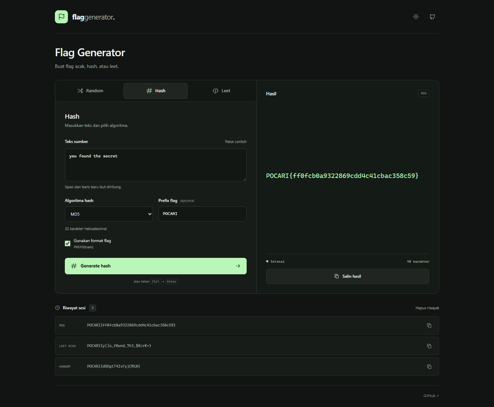
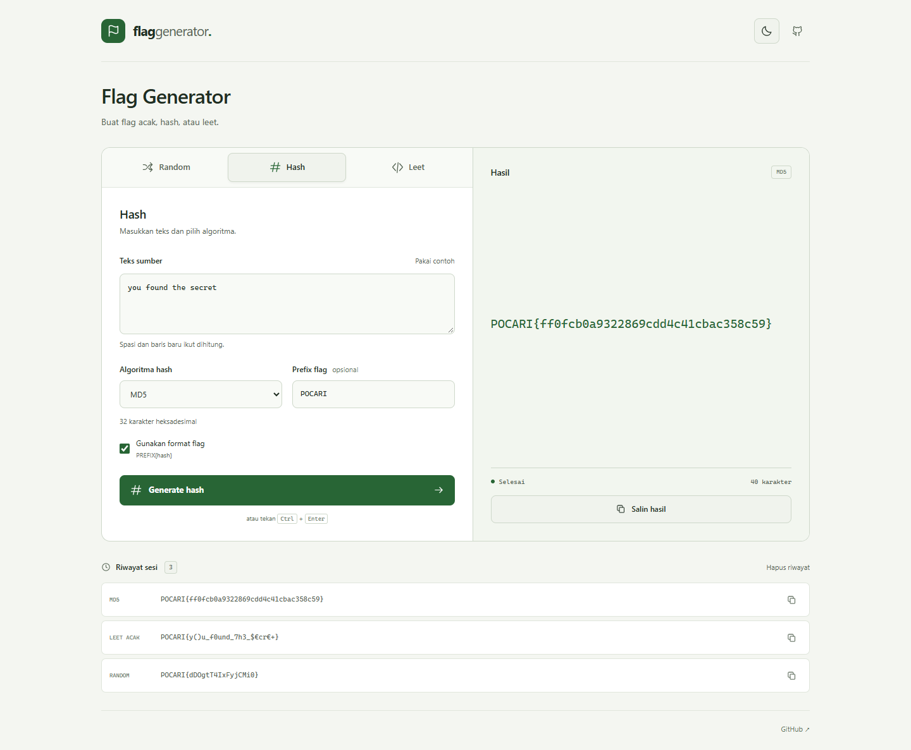

# Flag Generator

Generator flag CTF dengan mode Random, Hash, dan Leet. Menggunakan HTML, CSS, dan JavaScript tanpa proses build.



## Fitur

- **Random:** flag alfanumerik sepanjang 6–100 karakter, prefix opsional dengan default `FLAG`, dan pengacakan melalui `crypto.getRandomValues()` tanpa modulo bias.
- **Hash:** MD5, SHA-1, SHA-256, SHA-384, dan SHA-512, dengan hasil heksadesimal lengkap. Pilih hasil mentah atau format `PREFIX{hash}`.
- **Leet:** pilih secara acak antara huruf asli dan padanan angka, misalnya `a → a / 4` dan `s → s / 5`; opsi acak kapitalisasi serta mode Klasik dengan mapping asli.
- **UI responsif:** tiga tab, tema terang/gelap mengikuti preferensi sistem, hasil panjang yang membungkus baris, dan konfirmasi salin.
- **Riwayat sesi:** enam hasil terakhir dari semua mode, masing-masing bisa disalin. Riwayat disimpan dalam memori dan hilang saat halaman dimuat ulang.
- **Keyboard:** pindah tab dengan ← / →, Home, dan End; generate dengan Ctrl+Enter atau ⌘+Enter.

## Jalankan

Buka `index.html` langsung di browser modern, atau gunakan server lokal:

```sh
python -m http.server 8000
```

Buka `http://localhost:8000`. Tidak ada dependensi yang perlu diinstal.

SHA menggunakan Web Crypto API, yang memerlukan secure context. Gunakan HTTPS untuk hosting atau localhost saat pengembangan. Buka langsung melalui `file://` juga sudah diuji di Chrome; dukungan browser lain dapat berbeda. Jika Web Crypto tidak tersedia, aplikasi menampilkan pesan error.

## Cara pakai

### Random

1. Isi prefix event, atau kosongkan untuk `FLAG`.
2. Tentukan panjang isi flag (tidak termasuk prefix dan kurung).
3. Klik **Generate flag**, lalu **Salin hasil**.

### Hash

1. Pilih tab **Hash** dan masukkan teks sumber.
2. Pilih algoritma:

| Algoritma | Panjang hash (heksadesimal) |
| --- | --- |
| MD5 | 32 karakter |
| SHA-1 | 40 karakter |
| SHA-256 | 64 karakter |
| SHA-384 | 96 karakter |
| SHA-512 | 128 karakter |

3. Isi prefix jika perlu; kosong berarti `FLAG`.
4. Matikan **Gunakan format flag** untuk mendapatkan hash mentah.
5. Klik **Generate hash**.

Contoh: input `abc`, algoritma MD5, prefix `CTF`:

```text
CTF{900150983cd24fb0d6963f7d28e17f72}
```

Hash dihitung dari teks UTF-8 pada kolom input, termasuk spasi dan baris baru. Prefix dan kurung tidak ikut di-hash. Input kosong valid dan menghasilkan digest string kosong. Input dan algoritma yang sama menghasilkan hash yang sama; tidak ada salt acak.

### Leet

1. Pilih tab **Leet**, lalu masukkan teks.
2. Gunakan gaya **Acak** untuk memilih padanan secara independen pada tiap huruf. Klik lagi untuk mengacak ulang; hasil yang sama tetap mungkin, terutama untuk input pendek.
3. Pilih **Klasik** untuk mapping tetap: `A→4, E→3, T→7, S→5, G→9, O→0, L→1`.
4. Opsional: aktifkan acak huruf besar/kecil dan masukkan prefix.
5. Klik **Generate leet**. Prefix kosong menghasilkan teks leet tanpa pembungkus.

Hasil leet mengikuti pola `^[A-Za-z0-9_]+$`. Setiap spasi dan karakter whitespace diubah menjadi `_`. Simbol dan karakter di luar pola, termasuk emoji, dihapus. Jika hasilnya kosong, aplikasi meminta input lain. Pola ini berlaku untuk isi flag, sebelum prefix dan kurung ditambahkan.

## Privasi dan implementasi

Semua pemrosesan berlangsung di browser. Tidak ada API, unggahan, analytics, font eksternal, atau permintaan jaringan dari generator. Hanya pilihan tema yang disimpan di `localStorage`; input, hasil, dan riwayat tidak disimpan di sana. Jika penyimpanan browser diblokir, generator tetap berjalan.

MD5 tersedia secara lokal berdasarkan [RFC 1321](https://www.rfc-editor.org/rfc/rfc1321). SHA memakai [SubtleCrypto.digest](https://developer.mozilla.org/en-US/docs/Web/API/SubtleCrypto/digest). MD5 dan SHA-1 disediakan untuk kebutuhan challenge dan kompatibilitas; jangan gunakan keduanya untuk menyimpan password atau aplikasi yang membutuhkan ketahanan terhadap collision.

## Pengujian

Dengan Node.js 22 atau lebih baru:

```sh
node --test
node --check generator.js
node --check script.js
```

Tes memeriksa kelima hash terhadap implementasi `node:crypto`, termasuk input kosong, Unicode, whitespace, serta batas blok MD5. Tes juga mencakup mapping leet acak/klasik, kapitalisasi, panjang flag, prefix, dan batas bilangan acak.

Setelah mengubah CSS atau JavaScript, jalankan `node scripts/update-assets.cjs` sebelum tes dan deployment. Perintah ini memperbarui versi URL aset berdasarkan isi file, agar browser mengambil file baru. Tes memeriksa versi ini agar HTML tidak memakai aset lama dari cache.

Verifikasi browser dilakukan di Chrome: seluruh algoritma, clipboard, validasi, riwayat, navigasi keyboard, kedua tema, storage diblokir, jalur error, serta mode `file://`. Layout diperiksa pada lebar 320, 390, 768, 1024, dan 1440 px.

## Deployment

Untuk GitHub Pages, buka **Settings → Pages → Deploy from a branch**, lalu pilih branch `main` dan folder `/ (root)` setelah perubahan digabungkan.

File yang harus tersedia bersama:

```text
index.html
style.css
generator.js
script.js
favicon.svg
```

Hosting statis lain seperti Netlify, Vercel, dan Cloudflare Pages juga dapat menyajikan folder ini langsung tanpa build command.

<details>
<summary>Preview tema terang</summary>



</details>
